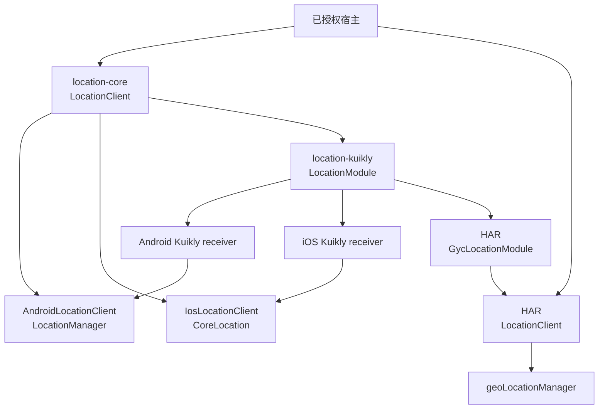
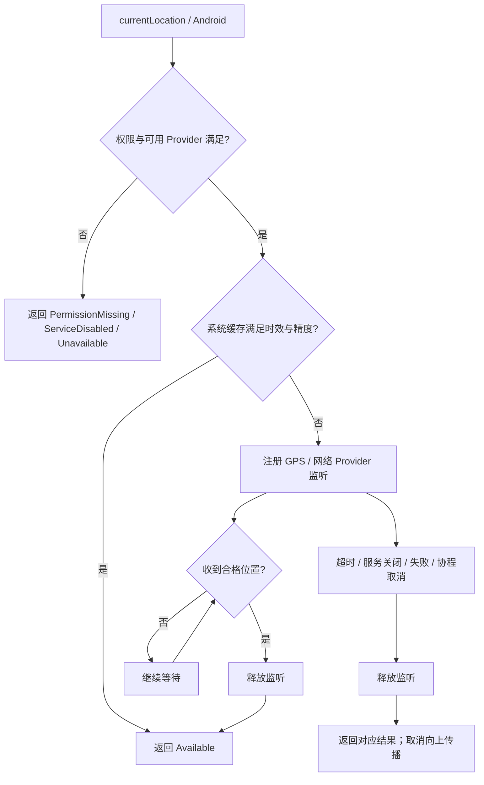
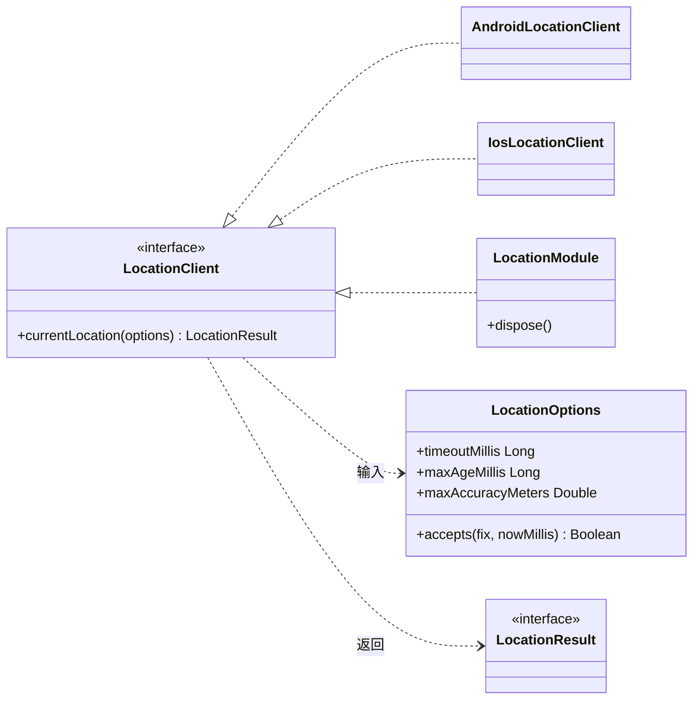

# GY CrossKit Location

Kuikly 由宿主统一选择版本；组件构建基线、允许范围及消费验证边界见[功能与平台差异](docs/功能与平台差异.md#kuikly-版本与宿主选择)。

> 当前 Maven 候选 **1.0.1** 尚未发布；下方 Maven 坐标须在发布并通过公开消费后使用。既有 `1.0.0` 不包含本轮改动，源码、公开消费与真机验收分别记录。

当前源码配套 Kuikly 2.29.1；历史 Tag 与验收记录保持原范围。新增 API 必须消费本轮配套源码，不能用旧远程版本代替验证。

本轮配套：iOS Git Pod 与 HarmonyOS HAR 均沿用 `1.0.0`（原生源码未变），不为空发版；Git Pod 不代表 CocoaPods Specs 发布。既有 [Maven 1.0.0](https://github.com/gycrosskit/location/releases/tag/1.0.0) 与 [HAR 1.0.0](https://github.com/gycrosskit/location/releases/tag/har-1.0.0) 保留原 Tag 和字节；OHPM Registry 是否可安装须独立核验。

## 当前功能与平台边界

core 提供前台单次定位、时效/精度过滤与取消；不提供地图或页面 UI，location-kuikly提供三端调用侧与 Android/iOS receiver。

当前测试覆盖、执行时点和未验收项集中见[验证范围](docs/功能与平台差异.md#验证范围)，复现命令见[开发与验证](docs/开发与验证.md)。

[历史完整源码审查](docs/完整源码审查.md) 列出全部生产文件、公开调用链、实际验证与未测项。

前台单次定位，提供权限/服务状态、取消、超时、缓存时效和精度过滤。保留系统原始坐标；权限申请、地址查询、坐标转换和业务精度要求由宿主负责。

## 平台与要求

| 平台 | 接入方式 | 系统要求 |
| --- | --- | --- |
| Android | KMP `location-core`，`LocationManager` | API 24+ |
| iOS | KMP `location-core`，`CoreLocation` | iOS 14+（使用实例 `authorizationStatus` API） |
| HarmonyOS | 原生 `location-native` HAR，`geoLocationManager` | 当前 HAR 的 target/compatible SDK 均为 API 22 |

KMP 使用 Kotlin `2.2.21-1.0.0`、coroutines `1.10.2`。`location-kuikly` 提供三端调用侧与 Android/iOS receiver，core 的 `ohosArm64` 变体只含公共 API。不提供 Swift Package；JVM 变体只含公共 API/数据与测试逻辑，无 JVM 定位实现。

## 架构与调用流程

`location-core` 统一单次定位参数与结果，权限由宿主提前取得。Android/iOS 使用各自系统定位实现；HarmonyOS 可直接使用 HAR，或经 `location-kuikly` 接线。JVM 只有公共 API，没有系统定位实现。



Android 的单次请求先检查权限、服务和合格缓存；只有需要新位置时才注册监听。结束后释放监听，协程取消继续向上传播。iOS 与 HAR 使用各自系统监听及缓存来源，具体实现见源码。



类图展示 KMP 契约；HarmonyOS ArkTS 的同名 `LocationClient` 是独立原生类，不是 Kotlin 接口的直接实现。



源码：[公共类型](location-core/src/commonMain/kotlin/io/github/gycrosskit/location/Location.kt)、[Android 实现](location-core/src/androidMain/kotlin/io/github/gycrosskit/location/AndroidLocationClient.kt)、[iOS 实现](location-core/src/iosMain/kotlin/io/github/gycrosskit/location/IosLocationClient.kt)、[Kuikly Module](location-kuikly/src/commonMain/kotlin/io/github/gycrosskit/location/kuikly/LocationModule.kt)、[HAR Module](ohos/location-native/src/main/ets/GycLocationModule.ets)、[HAR Client](ohos/location-native/src/main/ets/LocationClient.ets)。Kuikly 的取消、超时和 `dispose()` 按 requestId 取消对应原生请求；回执后也会再次检查页面是否销毁。

## 安装

以下 Maven 示例针对本轮候选；公开发布与精确版本消费通过前，不视为可用的远程坐标。

```kotlin
// settings.gradle.kts
dependencyResolutionManagement {
    repositories {
        maven("https://jitpack.io")
        maven("https://maven.eazytec-cloud.com/nexus/repository/maven-public/")
        google()
        mavenCentral()
    }
}
```

```kotlin
commonMain.dependencies {
    implementation("com.github.gycrosskit.location:location-core:1.0.1")
}
ohosArm64Main.dependencies {
    implementation("com.github.gycrosskit.location:location-kuikly:1.0.1")
}
```

HarmonyOS 原生包独立安装，沿用 `1.0.0`；[固定 Release HAR](https://github.com/gycrosskit/location/releases/tag/har-1.0.0) 与 Registry 可安装性分别核验，下方命令须以精确 Registry 查询/安装结果为准：

```sh
ohpm install @gycrosskit/location-native@1.0.0
```

## 最小使用

```kotlin
import io.github.gycrosskit.location.*

val client: LocationClient = AndroidLocationClient(context)
// iOS 平台入口用 IosLocationClient()。
// 先取得权限，再在页面生命周期绑定的协程中调用：
val result = client.currentLocation(LocationOptions(
    timeoutMillis = 12_000,
    maxAgeMillis = 300_000,
    maxAccuracyMeters = 100.0,
))
when (result) {
    is LocationResult.Available -> {
        val latitude = result.fix.latitude
        val longitude = result.fix.longitude
        // 交给宿主使用，fix 还包含精度和 Unix 毫秒时间。
    }
    LocationResult.PermissionMissing -> { /* 申请权限或展示引导 */ }
    LocationResult.ServiceDisabled -> { /* 展示系统定位服务引导 */ }
    LocationResult.TimedOut, LocationResult.Unavailable -> { /* 提示重试 */ }
}
```

HarmonyOS 的 `LocationClient.currentLocation` 返回带 `result` Promise 和 `cancel()` 的请求，见接入指南。

## 权限与生命周期

iOS 等待定位期间授权改为 `Restricted` 与 `Denied` 均返回 `PermissionMissing`；HAR 不允许负 Unix 时间戳通过较大的缓存预算变成有效读数。

Android 声明并取得 `ACCESS_COARSE_LOCATION` / `ACCESS_FINE_LOCATION`；iOS 填写 `NSLocationWhenInUseUsageDescription` 并提前授权；HarmonyOS 申请 `ohos.permission.APPROXIMATELY_LOCATION`，精确定位另加 `ohos.permission.LOCATION`。

库不将粗略授权直接判失败，位置满足 `maxAccuracyMeters` 才返回成功；拒绝非法经纬度、未来/过期坐标和不合格精度。KMP 请求协程取消会清理独占系统监听，保留取消语义；完成和超时同样清理。iOS 平台操作内部切换主线程。Android 监听存在且授权允许的 GPS/网络 Provider，请求中启用的 Provider 也可投递；Android 11（API30）起粗略授权允许 GPS 的系统模糊化位置，API24–29 粗略授权仅使用网络。第一份合格位置才返回成功，Provider 切换不等于系统定位关闭。

HarmonyOS 页面销毁时调用请求 `cancel()`；优先复用实例内的合格位置，否则读取系统上次位置；无历史位置或时效/精度不合格时等待新读数。每次读取重新检查权限、服务、时效和精度，不持久化位置。不提供后台或持续定位。GPS、室内/室外、权限和后台生命周期需真实设备验收。

## 文档与帮助

- [接入指南](docs/接入指南.md)：平台初始化、权限声明和生命周期。
- [开发与验证](docs/开发与验证.md)：源码构建、检查命令与验收范围。
- [版本与发行说明](https://github.com/gycrosskit/location/releases)、[问题反馈](https://github.com/gycrosskit/location/issues)。

Apache-2.0，见 [LICENSE](LICENSE)。

<a id="011-候选kuikly-单次定位"></a>

## Kuikly 单次定位

使用 `location-kuikly` 与原生 `GycLocationModule`，每个 Page 各注册一个对应 Module；依赖版本见上方安装章节。

```kotlin
val location = io.github.gycrosskit.location.kuikly.LocationModule(bridgeTimeoutMillis = 12_000)
val result = location.currentLocation(LocationOptions(timeoutMillis = 10_000, maxAgeMillis = 300_000, maxAccuracyMeters = 500.0))
// pageWillDestroy: location.dispose()
```

宿主映射业务坐标/结果；协程取消、超时和dispose同时取消原生定位，旧请求ID不能停止后继请求。原生Client验证系统时间、缓存和精度；组件不弹权限申请、不转换坐标系。
## 历史发布记录

以下记录保留对应版本、渠道与验收时点，不替代顶部当前功能和安装基线。

- <a id="013-发布状态"></a>[0.1.3 发布验收](docs/0.1.3发布验收.md)。
- <a id="012-历史-prerelease"></a>[0.1.2 发布验收与 watchdog 合同](docs/发布验收-0.1.2.md)、[对应更新日志](CHANGELOG.md#012)。
- <a id="011-历史-prerelease"></a>[0.1.1 Kuikly 候选与远程发布验收](verification-consumer/候选验收.md)。

## 自动回归

当前源码回归使用[统一远程验证（Jenkins）](https://github.com/gycrosskit/.github/blob/main/docs/统一远程验证.md)，按已推送源码 ref/SHA 选择对应组件；平台命令与参数以受信 Jenkins recipe 为准。实际执行范围、测试数量、结果与耗时以绑定源码/CI SHA 的构建回执为准，轻量检查或跳过不算平台测试通过。

候选冻结与消费按[发布流程](https://github.com/gycrosskit/.github/blob/main/docs/发布流程.md)使用独立 Job：`component-ci/package` 绑定准确 SOURCE_SHA 生成冻结候选并验证私有消费，`component-ci/release` 绑定准确 Tag/候选执行发布及独立公开消费。核对冻结归档、精确 tag/commit、完整 publication 清单和公开文件，不使用 `mavenLocal`、本库源码或 staging 替换公开依赖；各阶段证据分别记录。

OHOS KLIB 编译不代表 HAR 构建、ohpm 上架或真机验收。HAR 通过统一入口独立构建与消费，各阶段以对应准确源码 SHA 的回执为准。

阶段、缓存、有限网络重试、失败记录与证据边界见[共用 CI 规则](https://github.com/gycrosskit/.github/blob/main/docs/持续集成门禁.md)；本库实际平台命令以 Jenkins 的固定版本 recipe 为准。源码通过、远程消费、HAR/ohpm 与设备验收分别记录。

历史 `0.1.3` 的 iOS KLIB 引用了 SDK 26 的 `_LocationEssentials`。当前源码与发布消费者统一以 Xcode/iOS SDK 27.1 编译，仍实查该框架，Simulator 验收采用共用 CI 的 runtime 27.0 基线；不绑定某台机器的 Xcode 安装路径。该构建 SDK 变更不提高组件现有 iOS 14+ 的 deployment target，也不新增系统 API。此处配置已调整，真实 SDK 验收结果仍以本轮准确 SHA 的回执为准。
